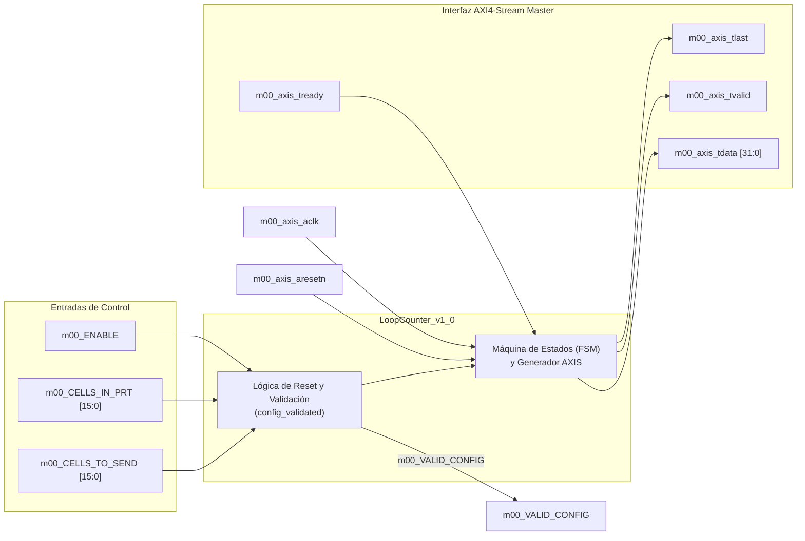
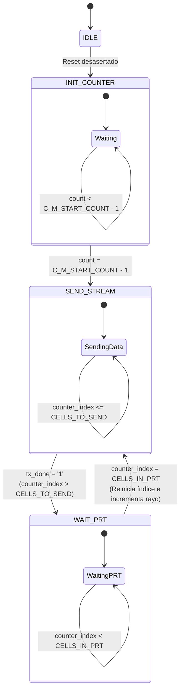
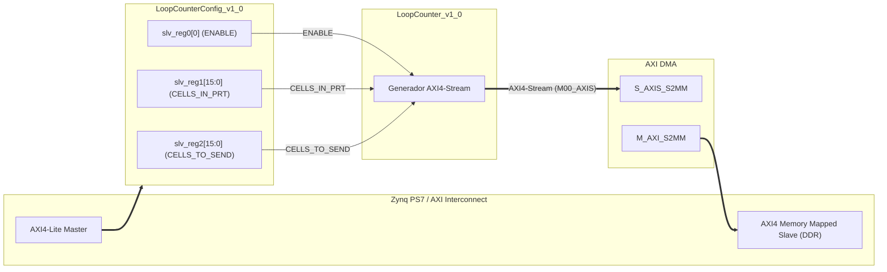

# Guía del Producto: LoopCounter v1.0 IP Core

## 1. Resumen General (Overview)

El IP Core **LoopCounter_v1_0** es un generador de tráfico **AXI4-Stream Master** diseñado para el simulador de datos del proyecto **DRX** (Receptor Digital de Radar). Este IP simula la adquisición de celdas de distancia dentro de un Período de Repetición de Pulso (PRT - *Pulse Repetition Time*).

Permite configurar de forma dinámica la cantidad total de celdas que componen un rayo radar (`CELLS_IN_PRT`) y el número de celdas efectivas a capturar y transferir (`CELLS_TO_SEND`). Adicionalmente, incluye un contador de transacciones/rayos en la cabecera de cada ráfaga AXI4-Stream para garantizar la trazabilidad de los datos transferidos hacia el Procesador (*Processing System* - PS) vía AXI DMA.

### Características Clave
- **Interfaz AXI4-Stream Master (M00_AXIS)**: Transmisión directa de datos de alta velocidad con soporte del protocolo de *handshake* (`TVALID`/`TREADY`) y señalización de fin de paquete (`TLAST`).
- **Control Periódico del PRT**: Simulación exacta del tiempo entre pulsos de radar.
- **Cabecera de Trazabilidad**: Envío del número consecutivo de transacción (`transaction_counter`) en la primera muestra del paquete (`index 0`).
- **Validación Automática de Configuración**: Verificación en hardware de la condición de consistencia `CELLS_IN_PRT >= CELLS_TO_SEND` señalizada mediante la salida `VALID_CONFIG`.
- **Ancho de Datos Configurable**: Parámetros genéricos ajustables para ancho de bus AXI4-Stream (por defecto 32 bits) y ancho del contador de celdas (por defecto 16 bits).

---

## 2. Diagrama de Bloques y Arquitectura Interna

### Diagrama de Bloques General

### Arquitectura de la FSM (Máquina de Estados Finitos)

La FSM controla el flujo de envío de datos del flujo AXI4-Stream y la temporización del PRT:

1. **IDLE**: Estado inicial de reposo tras el reset. Transiciona automáticamente a `INIT_COUNTER`.
2. **INIT_COUNTER**: Introduce una retardo configurable (`C_M_START_COUNT` ciclos de reloj) antes de iniciar la transmisión.
3. **SEND_STREAM**: Genera el paquete AXI4-Stream.
   - Envía el `transaction_counter` cuando `counter_index = 0`.
   - Envía el valor del contador de celdas (`counter_index`) para `1 <= counter_index <= CELLS_TO_SEND`.
   - Asienta la señal `m00_axis_tlast` cuando `counter_index = CELLS_TO_SEND`.
4. **WAIT_PRT**: Mantiene la pausa correspondiente al tiempo restante del pulso hasta que `counter_index` alcance el valor de `CELLS_IN_PRT`. Al finalizar, reinicia `counter_index` a 0, incrementa el `transaction_counter` y regresa a `SEND_STREAM`.

---

## 3. Parámetros Genéricos (Generics)

| Nombre del Genérico | Tipo | Valor por Defecto | Descripción |
| :--- | :--- | :--- | :--- |
| **M00_CELLS_DATA_WIDTH** | `integer` | `16` | Ancho en bits del contador de celdas ($2^{\text{WIDTH}}$ celdas máx.). |
| **C_M00_AXIS_TDATA_WIDTH** | `integer` | `32` | Ancho del bus de datos AXI4-Stream (`TDATA`). |
| **C_M00_AXIS_START_COUNT** | `integer` | `32` | Número de ciclos de reloj de espera antes de iniciar la primera transacción. |

---

## 4. Descripción de Puertos e Interfaces

### Puertos de Control y Configuración
| Nombre del Puerto | Dirección | Tipo | Descripción |
| :--- | :--- | :--- | :--- |
| **m00_ENABLE** | Entrada | `std_logic` | Habilitador global del IP (Reset asíncrono activo en '1' si se combina con reset del bus). |
| **m00_CELLS_IN_PRT** | Entrada | `std_logic_vector(15 downto 0)` | Número total de celdas por período de pulso (PRT). |
| **m00_CELLS_TO_SEND** | Entrada | `std_logic_vector(15 downto 0)` | Número de celdas a adquirir y transmitir en cada rayo. |
| **m00_VALID_CONFIG** | Salida | `std_logic` | Indica que la configuración es válida (`CELLS_IN_PRT >= CELLS_TO_SEND`). |

### Puertos de la Interfaz AXI4-Stream Master (`M00_AXIS`)
| Nombre del Puerto | Dirección | Tipo | Descripción |
| :--- | :--- | :--- | :--- |
| **m00_axis_aclk** | Entrada | `std_logic` | Reloj principal del bus AXI4-Stream. |
| **m00_axis_aresetn** | Entrada | `std_logic` | Reset global del bus AXI4-Stream (Activo en bajo '0'). |
| **m00_axis_tvalid** | Salida | `std_logic` | Indica que los datos en `m00_axis_tdata` son válidos. |
| **m00_axis_tdata** | Salida | `std_logic_vector(31 downto 0)` | Bus de datos de salida del stream. |
| **m00_axis_tstrb** | Salida | `std_logic_vector(3 downto 0)` | Calificador de bytes (fijo en `"1111"`). |
| **m00_axis_tlast** | Salida | `std_logic` | Señal de fin de paquete/trama AXI4-Stream. |
| **m00_axis_tready** | Entrada | `std_logic` | Señal del esclavo (DMA/FIFO) indicando capacidad para recibir datos. |

---

## 5. Formato del Paquete y Cronograma de Transmisión

### Estructura de la Trama AXI4-Stream
Cada paquete transmitido por `LoopCounter_v1_0` consta de $N + 1$ palabras (donde $N = \text{CELLS\_TO\_SEND}$):

| Muestra / Índice | Valor en `m00_axis_tdata[31:0]` | Señal `m00_axis_tlast` |
| :---: | :---: | :---: |
| **0** | `transaction_counter` (ID consecutivo del pulso/rayo) | `'0'` |
| **1** | `0x00000001` (Índice de celda 1) | `'0'` |
| **2** | `0x00000002` (Índice de celda 2) | `'0'` |
| ... | ... | ... |
| **N** | `N` (Índice de celda $N = \text{CELLS\_TO\_SEND}$) | `'1'` |

### Reglas de Validación de Configuración
El módulo evalúa continuamente la condición:
$$\text{config\_validated} = \begin{cases} 1 & \text{si } \text{CELLS\_IN\_PRT} \ge \text{CELLS\_TO\_SEND} \\ 0 & \text{en otro caso} \end{cases}$$

Si la configuración no es válida (`VALID_CONFIG = '0'`), el IP se mantiene en estado de reset interno y no genera transacciones AXI4-Stream.

---

## 6. Ejemplos de Integración en Vivado

El IP **LoopCounter_v1_0** se conecta típicamente en un diseño de bloques (*Block Design*) conjuntamente con:
1. **LoopCounterConfig_v1_0**: Proporciona las señales `m00_ENABLE`, `m00_CELLS_IN_PRT` y `m00_CELLS_TO_SEND` registradas mediante AXI4-Lite desde el Procesador (Zynq PS).
2. **AXI Direct Memory Access (AXI DMA)**: Recibe el flujo AXI4-Stream en su puerto esclavo `S_AXIS_S2MM` y realiza transferencias cíclicas hacia la memoria DDR del PS.

