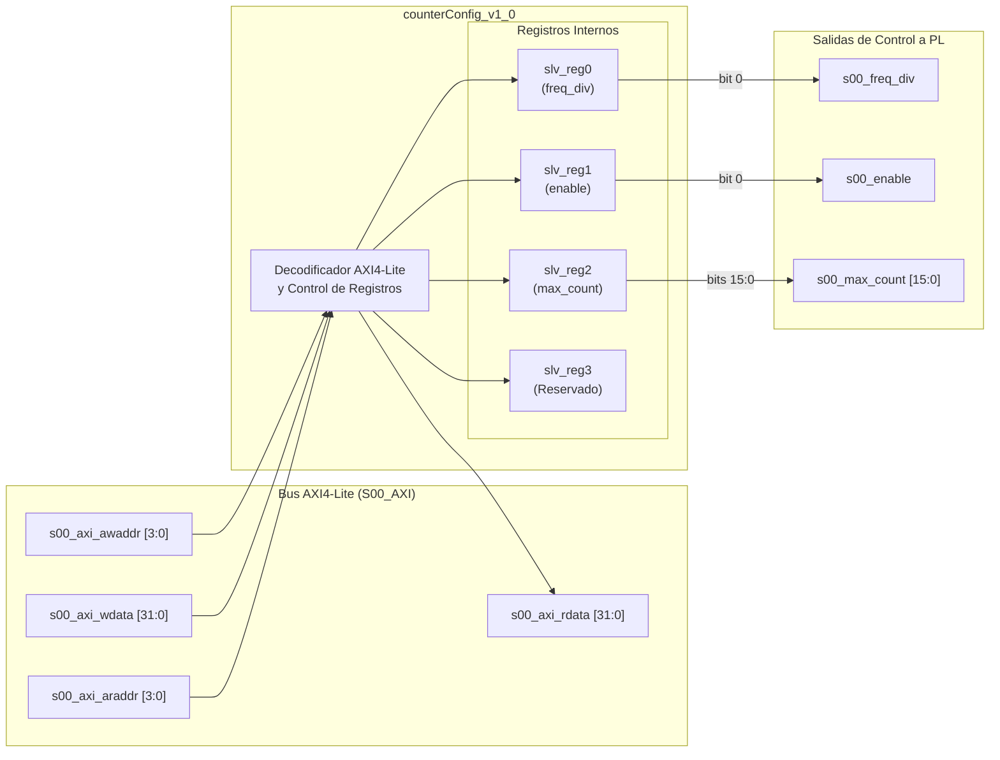

# Guía del Producto: counterConfig v1.0 IP Core

## 1. Resumen General (Overview)

El IP Core **counterConfig_v1_0** es un módulo de configuración con interfaz **AXI4-Lite Slave (S00_AXI)** diseñado para controlar de forma dinámica el simulador de contador **counterSimulator_v1_0** desde el procesador Zynq PS.

Proporciona registros mapeados en memoria para ajustar los siguientes parámetros clave de la simulación:
1. **Divisor de Frecuencia / Resolución (`freq_div`)**: Selección entre modo de resolución de celdas (p. ej. 125m o 250m).
2. **Cuenta Máxima de Muestras (`max_count`)**: Definición de la cantidad total de palabras de datos a transmitir por bloque.
3. **Habilitación de Generación (`enable`)**: Activación y desactivación del flujo AXI4-Stream.

### Características Clave
- **Interfaz AXI4-Lite Slave Standard**: Mapeo transparente en el mapa de memoria del sistema Zynq.
- **Acceso Lectura/Escritura en Todos los Registros**: Facilidad para verificación de estado y lectura de configuración activa por el software.
- **Control Sincrónico**: Generación de salidas de control registradas directamente vinculables a la lógica en PL.
- **Driver C Incluido**: Código fuente C (`counterConfig.h`, `counterConfig.c`) en el directorio `drivers/` para rápida integración en firmware/kernel Linux.

---

## 2. Diagrama de Bloques y Arquitectura Interna



---

## 3. Parámetros Genéricos (Generics)

| Nombre del Genérico | Tipo | Valor por Defecto | Descripción |
| :--- | :--- | :--- | :--- |
| **s00_counter_bits** | `integer` | `16` | Ancho en bits de la salida `s00_max_count`. |
| **C_S00_AXI_DATA_WIDTH** | `integer` | `32` | Ancho de datos AXI4-Lite (fijo en 32 bits). |
| **C_S00_AXI_ADDR_WIDTH** | `integer` | `4` | Ancho de dirección AXI4-Lite (4 bits para 4 registros). |

---

## 4. Mapa de Registros (Register Map)

| Offset de Dirección | Registro | Acceso | Valor por Defecto | Descripción |
| :---: | :---: | :---: | :---: | :--- |
| **`0x00`** | `slv_reg0` | R/W | `0x00000000` | Registro Divisor de Frecuencia / Configuración. |
| **`0x04`** | `slv_reg1` | R/W | `0x00000000` | Registro de Habilitación / Reset. |
| **`0x08`** | `slv_reg2` | R/W | `0x00000000` | Registro de Cuenta Máxima (`max_count`). |
| **`0x0C`** | `slv_reg3` | R/W | `0x00000000` | Registro reservado. |

### Detalle de Campos de Bits por Registro

#### 1. Registro `slv_reg0` (Offset `0x00`) - Divisor de Frecuencia
| Bits | Nombre | Acceso | Descripción |
| :---: | :--- | :---: | :--- |
| `0` | **freq_div** | R/W | Selecciona el modo/divisor de frecuencia (p. ej. `'0'` = 125m, `'1'` = 250m celdas). |
| `31:1` | *Reservado* | R/O | Retorna '0'. |

#### 2. Registro `slv_reg1` (Offset `0x04`) - Habilitador
| Bits | Nombre | Acceso | Descripción |
| :---: | :--- | :---: | :--- |
| `0` | **enable** | R/W | **Control de Habilitación**: `'1'` = Generación activa; `'0'` = Generador deshabilitado. |
| `31:1` | *Reservado* | R/O | Retorna '0'. |

#### 3. Registro `slv_reg2` (Offset `0x08`) - Cuenta Máxima
| Bits | Nombre | Acceso | Descripción |
| :---: | :--- | :---: | :--- |
| `15:0` | **max_count** | R/W | Tamaño de ráfaga/cuenta límite transferida a `counterSimulator_v1_0`. |
| `31:16` | *Reservado* | R/O | Retorna '0'. |

---

## 5. Descripción de Puertos e Interfaces

### Puertos de Salida de Control hacia PL
| Nombre del Puerto | Dirección | Tipo | Descripción |
| :--- | :--- | :--- | :--- |
| **s00_freq_div** | Salida | `std_logic` | Salida directa de `slv_reg0(0)`. |
| **s00_enable** | Salida | `std_logic` | Salida directa de `slv_reg1(0)`. |
| **s00_max_count** | Salida | `std_logic_vector(15 downto 0)` | Bus de salida desde `slv_reg2(15 downto 0)`. |

### Interfaz AXI4-Lite Slave (`S00_AXI`)
| Nombre del Puerto | Dirección | Tipo | Descripción |
| :--- | :--- | :--- | :--- |
| **s00_axi_aclk** | Entrada | `std_logic` | Reloj del bus AXI4-Lite. |
| **s00_axi_aresetn** | Entrada | `std_logic` | Reset AXI4-Lite activo en bajo ('0'). |
| **s00_axi_awaddr** | Entrada | `std_logic_vector(3 downto 0)` | Dirección de escritura AXI4-Lite. |
| **s00_axi_awvalid** | Entrada | `std_logic` | Dirección de escritura válida. |
| **s00_axi_awready** | Salida | `std_logic` | Esclavo listo para recibir dirección de escritura. |
| **s00_axi_wdata** | Entrada | `std_logic_vector(31 downto 0)` | Datos de escritura. |
| **s00_axi_wstrb** | Entrada | `std_logic_vector(3 downto 0)` | Estrobos de escritura. |
| **s00_axi_wvalid** | Entrada | `std_logic` | Datos de escritura válidos. |
| **s00_axi_wready** | Salida | `std_logic` | Esclavo listo para datos de escritura. |
| **s00_axi_bresp** | Salida | `std_logic_vector(1 downto 0)` | Respuesta de escritura. |
| **s00_axi_bvalid** | Salida | `std_logic` | Respuesta de escritura válida. |
| **s00_axi_bready** | Entrada | `std_logic` | Maestro listo para respuesta. |
| **s00_axi_araddr** | Entrada | `std_logic_vector(3 downto 0)` | Dirección de lectura AXI4-Lite. |
| **s00_axi_arvalid** | Entrada | `std_logic` | Dirección de lectura válida. |
| **s00_axi_arready** | Salida | `std_logic` | Esclavo listo para dirección de lectura. |
| **s00_axi_rdata** | Salida | `std_logic_vector(31 downto 0)` | Datos de lectura AXI4-Lite. |
| **s00_axi_rresp** | Salida | `std_logic_vector(1 downto 0)` | Respuesta de lectura. |
| **s00_axi_rvalid** | Salida | `std_logic` | Datos de lectura válidos. |
| **s00_axi_rready** | Entrada | `std_logic` | Maestro listo para recibir datos de lectura. |

---

## 6. Ejemplo de Uso de API de Software C

Utilizando el driver autogenerado en `drivers/counterConfig_v1_0/src/counterConfig.h`:

```c
#include "counterConfig.h"
#include "xil_io.h"

#define COUNTER_CFG_BASEADDR 0x43C10000 // Dirección base AXI4-Lite

void init_counter_simulator(u32 base_addr, u16 num_samples, u8 freq_mode) {
    // 1. Inhabilitar el generador
    COUNTERCONFIG_mWriteReg(base_addr, COUNTERCONFIG_S00_AXI_SLV_REG1_OFFSET, 0);

    // 2. Configurar modo de frecuencia / división
    COUNTERCONFIG_mWriteReg(base_addr, COUNTERCONFIG_S00_AXI_SLV_REG0_OFFSET, freq_mode & 0x01);

    // 3. Configurar número máximo de cuentas por paquete
    COUNTERCONFIG_mWriteReg(base_addr, COUNTERCONFIG_S00_AXI_SLV_REG2_OFFSET, num_samples);

    // 4. Habilitar la generación
    COUNTERCONFIG_mWriteReg(base_addr, COUNTERCONFIG_S00_AXI_SLV_REG1_OFFSET, 1);
}
```
