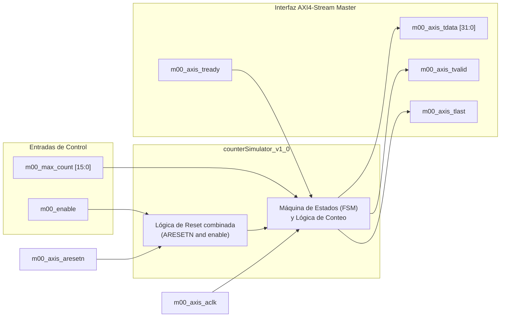
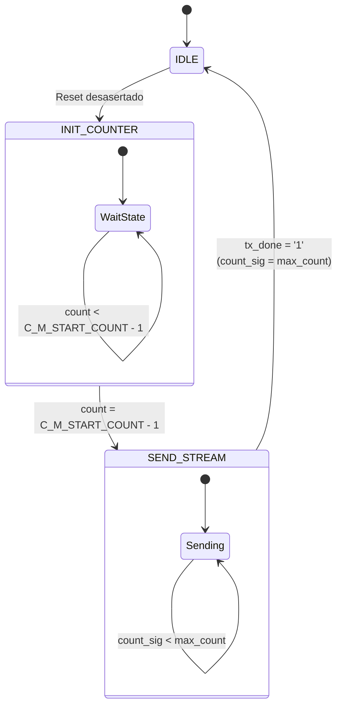
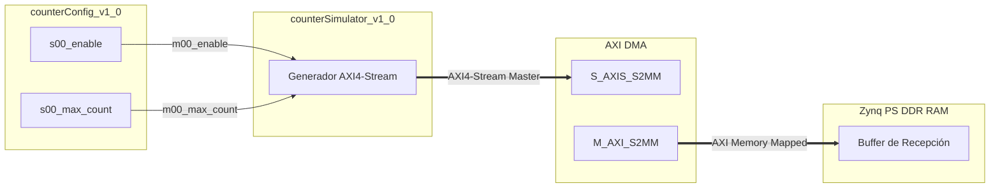

# Guía del Producto: counterSimulator v1.0 IP Core

## 1. Resumen General (Overview)

El IP Core **counterSimulator_v1_0** es un generador de prueba de datos **AXI4-Stream Master (M00_AXIS)**. Su función principal dentro del proyecto **DRX** es la generación secuencial y verificable de patrones numéricos consecutivos (contadores) para pruebas de flujo de datos, ancho de banda y transferencia mediante DMA (*Direct Memory Access*) hacia el procesador PS.

Permite simular ráfagas de datos en bloques de tamaño configurable (`max_count` / `NUMBER_OF_OUTPUT_WORDS`), facilitando la validación de integridad de datos e identificación de pérdida de paquetes en el sistema receptor.

### Características Clave
- **Interfaz AXI4-Stream Master**: Compatibilidad nativa con la especificación AXI4-Stream de Xilinx con señales de control de flujo (`TVALID`, `TREADY`) y de paquete (`TLAST`).
- **Secuencia de Datos Verificable**: Generación de datos correlativos incrementales ($0, 1, 2, \dots, N-1$) en cada ráfaga.
- **Tamaño de Ráfaga Programable**: Entrada `m00_max_count` que define la cantidad exacta de palabras transmitidas por paquete.
- **Espera de Inicio Configurable**: Parámetro genérico `C_M00_AXIS_START_COUNT` para ajustar el tiempo de estabilización antes de comenzar la transmisión.

---

## 2. Diagrama de Bloques y Arquitectura Interna

### Descripción de la Máquina de Estados Finitos (FSM)

- **IDLE**: Estado inicial de inactividad tras el reset. Transiciona inmediatamente a `INIT_COUNTER`.
- **INIT_COUNTER**: Aguarda `C_M_START_COUNT` ciclos de reloj para permitir la inicialización de los componentes receptores downstream.
- **SEND_STREAM**: Genera secuencialmente las palabras del contador.
  - La señal `m00_axis_tvalid` se asienta cuando la FSM está en `SEND_STREAM` y el contador de muestras `count_sig < max_count`.
  - La señal `m00_axis_tlast` se habilita exactamente en la última muestra del bloque (`count_sig = max_count - 1`).
  - Al completar el envío de la ráfaga (`tx_done = '1'`), regresa a `IDLE` para preparar la siguiente secuencia.

---

## 3. Parámetros Genéricos (Generics)

| Nombre del Genérico | Tipo | Valor por Defecto | Descripción |
| :--- | :--- | :--- | :--- |
| **C_M00_counter_bits** | `integer` | `16` | Ancho en bits del contador incremental interno. |
| **C_M00_AXIS_TDATA_WIDTH** | `integer` | `32` | Ancho del bus de datos AXI4-Stream (`TDATA`). |
| **C_M00_AXIS_START_COUNT** | `integer` | `32` | Ciclos de reloj de espera inicial antes de activar la ráfaga AXI4-Stream. |

---

## 4. Descripción de Puertos e Interfaces

### Puertos de Control e Entradas de Configuración
| Nombre del Puerto | Dirección | Tipo | Descripción |
| :--- | :--- | :--- | :--- |
| **m00_enable** | Entrada | `std_logic` | Habilitador activo en alto ('1'). Al ponerse en '0' reinicia la FSM e índice interno. |
| **m00_max_count** | Entrada | `std_logic_vector(15 downto 0)` | Número total de palabras de 32 bits a generar en cada paquete. |

### Interfaz AXI4-Stream Master (`M00_AXIS`)
| Nombre del Puerto | Dirección | Tipo | Descripción |
| :--- | :--- | :--- | :--- |
| **m00_axis_aclk** | Entrada | `std_logic` | Reloj principal AXI4-Stream. |
| **m00_axis_aresetn** | Entrada | `std_logic` | Reset del bus AXI4-Stream (Activo en '0'). |
| **m00_axis_tvalid** | Salida | `std_logic` | Asertada en '1' cuando hay datos válidos en `m00_axis_tdata`. |
| **m00_axis_tdata** | Salida | `std_logic_vector(31 downto 0)` | Salida con el valor del contador incremental de datos. |
| **m00_axis_tstrb** | Salida | `std_logic_vector(3 downto 0)` | Estrobos de byte (fijos a `"1111"`). |
| **m00_axis_tlast** | Salida | `std_logic` | Asertada en '1' sincronizada con la última muestra del bloque (`max_count - 1`). |
| **m00_axis_tready** | Entrada | `std_logic` | Entrada de preparación del esclavo (DMA/FIFO) para recibir la muestra. |

---

## 5. Estructura de Salida de Datos

En cada paquete AXI4-Stream transmitido, la señal `m00_axis_tdata` toma la siguiente secuencia:

| Muestra # | Valor de `m00_axis_tdata[31:0]` | Estado de `m00_axis_tlast` |
| :---: | :---: | :---: |
| 0 | `0x00000000` | `'0'` |
| 1 | `0x00000001` | `'0'` |
| 2 | `0x00000002` | `'0'` |
| ... | ... | ... |
| $M - 1$ | $M - 1$ | `'1'` |

*(Donde $M = \text{m00\_max\_count}$)*.

---

## 6. Integración en el Proyecto DRX

El módulo **counterSimulator_v1_0** se conecta en el diseño de hardware `counter_dma.bd` con los siguientes elementos:
1. **counterConfig_v1_0**: Suministra los valores de control `m00_enable` y `m00_max_count` vía AXI4-Lite.
2. **AXI Direct Memory Access (DMA)**: Conectado a la salida `M00_AXIS` para transferir cíclicamente la secuencia de prueba hacia la memoria RAM del sistema.

