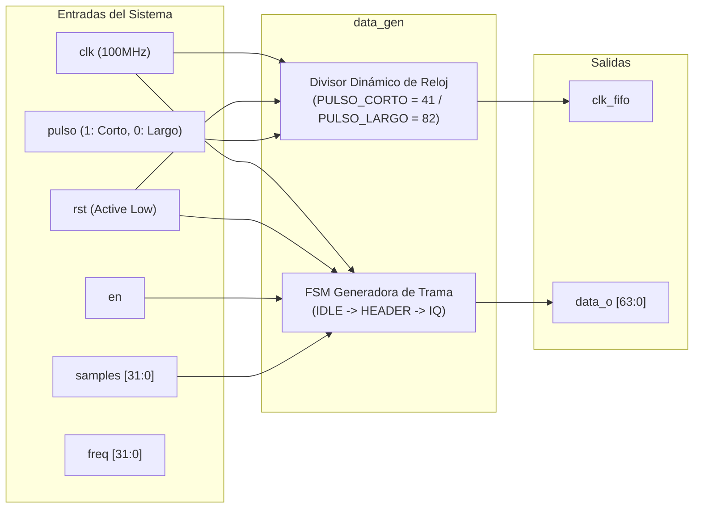
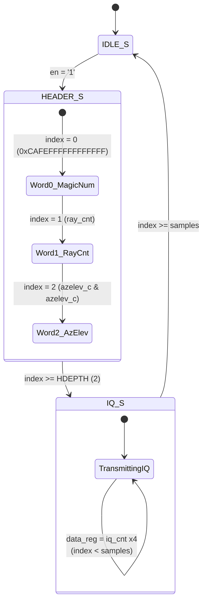

# Guía del Producto: Módulo Generador de Datos IQ (`data_gen`)

## 1. Resumen General (Overview)

El módulo **data_gen** es un generador de muestras IQ sintético para el sistema **DRX** (Receptor Digital de Radar). Este IP emula la salida del frontal de RF de radar, sintetizando ráfagas de datos en formato de 64 bits por palabra compuestas por una cabecera de trama (*header*) de metadatos del rayo y un conjunto de muestras IQ complejas.

Incluye la lógica de generación del reloj de FIFO (`clk_fifo`) con divisor dinámico en función del ancho de pulso transmitido (pulso corto / pulso largo).

### Características Clave
- **Ancho de Bus de Datos de 64 bits (`data_o`)**: Empaquetamiento de datos de alta densidad para la interfaz de memoria / FIFO.
- **Cabecera de Rayo Estructurada (*Header*)**:
  - Número Mágico de Sincronización de 64 bits (`0xCAFEFFFFFFFFFFFF`).
  - Contador secuencial de rayos (`ray_cnt`).
  - Posición angular concatenada de Azimut y Elevación (`azelev_c & azelev_c`).
- **Formato de Muestras IQ de 16 bits**: Muestras replicadas de 16 bits para canales I/Q.
- **División Dinámica de Reloj de FIFO (`clk_fifo`)**:
  - Modo Pulso Corto: División para $1.2\text{ MHz}$ (período de 41 ciclos a $100\text{ MHz}$).
  - Modo Pulso Largo: División para $600\text{ kHz}$ (período de 82 ciclos a $100\text{ MHz}$).

---

## 2. Diagrama de Bloques y FSM Interna



### Máquina de Estados Finitos (FSM) de Generación de Trama



1. **IDLE_S**: Reinicia contadores locales (`iq_cnt`, `index`). Si la señal de entrada `en = '1'`, evoluciona hacia `HEADER_S`.
2. **HEADER_S**: Genera secuencialmente las 3 palabras de 64 bits de la cabecera:
   - `index = 0`: Asigna el Número Mágico `0xCAFEFFFFFFFFFFFF`.
   - `index = 1`: Asigna el contador de rayo `ray_cnt` (incrementándolo en +1 para el próximo pulso).
   - `index = 2`: Asigna el vector combinado de Azimut y Elevación `azelev_c & azelev_c` (incrementándolo en +1).
   - Al alcanzar `index >= 2` (HDEPTH), cambia a `IQ_S`.
3. **IQ_S**: Genera palabras con muestras IQ repetidas de 16 bits en el vector de 64 bits:
   `data_reg <= iq_cnt & iq_cnt & iq_cnt & iq_cnt;`
   Incrementa `iq_cnt` e `index` en cada ciclo de reloj. Permanece en este estado hasta que `index >= to_integer(unsigned(samples))`, retornando a `IDLE_S`.

---

## 3. Parámetros Genéricos (Generics)

| Nombre | Tipo | Valor por Defecto | Descripción |
| :--- | :--- | :--- | :--- |
| **CLK_FREQ** | `integer` | `100000000` | Frecuencia de reloj del sistema de entrada en Hz (100 MHz por defecto). |

---

## 4. Descripción de Puertos e Interfaces

| Nombre del Puerto | Dirección | Tipo | Descripción |
| :--- | :--- | :--- | :--- |
| **clk** | Entrada | `std_logic` | Reloj principal del sistema (100 MHz). |
| **rst** | Entrada | `std_logic` | Reset asíncrono activo en bajo ('0'). |
| **en** | Entrada | `std_logic` | Habilitador de inicio de trama radar. |
| **pulso** | Entrada | `std_logic` | Selección de tipo de pulso: `'1'` = Pulso corto (1.2 MHz), `'0'` = Pulso largo (600 kHz). |
| **samples** | Entrada | `std_logic_vector(31 downto 0)` | Cantidad de muestras IQ a generar por trama/rayo. |
| **freq** | Entrada | `std_logic_vector(31 downto 0)` | Control de frecuencia de repetición/configuración. |
| **data_o** | Salida | `std_logic_vector(63 downto 0)` | Bus de datos de salida de 64 bits. |
| **clk_fifo** | Salida | `std_logic` | Reloj de escritura derivado para sincronizar la FIFO de muestras IQ. |

---

## 5. Estructura de la Trama de Salida (`data_o`)

| Palabra # / Tipo | Valor de `data_o[63:0]` | Descripción |
| :---: | :---: | :--- |
| **0 (Header)** | `0xCAFEFFFFFFFFFFFF` | Número Mágico de Sincronización. |
| **1 (Header)** | `ray_cnt[63:0]` | Contador acumulativo de rayos transmitidos. |
| **2 (Header)** | `azelev_c[31:0] & azelev_c[31:0]` | Datos de posición de antena (Azimut / Elevación). |
| **3 a N (IQ Muestras)** | `iq_cnt[15:0] & iq_cnt[15:0] & iq_cnt[15:0] & iq_cnt[15:0]` | Datos IQ sintéticos incrementales. |

---

## 6. Guía de Simulación y Testbench

Para verificar el comportamiento del módulo mediante el banco de pruebas VHDL `data_gen_tb.vhd`:

```bash
cd Vivado/src/data_gen
./simulate.sh
```
El script compila el código VHDL con `ghdl` o ejecutable de simulación de Vivado y genera la forma de onda para analizar el protocolo de trama IQ y la división de reloj `clk_fifo`.
